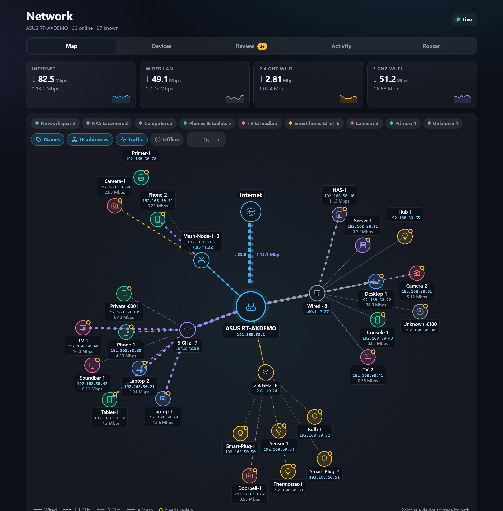
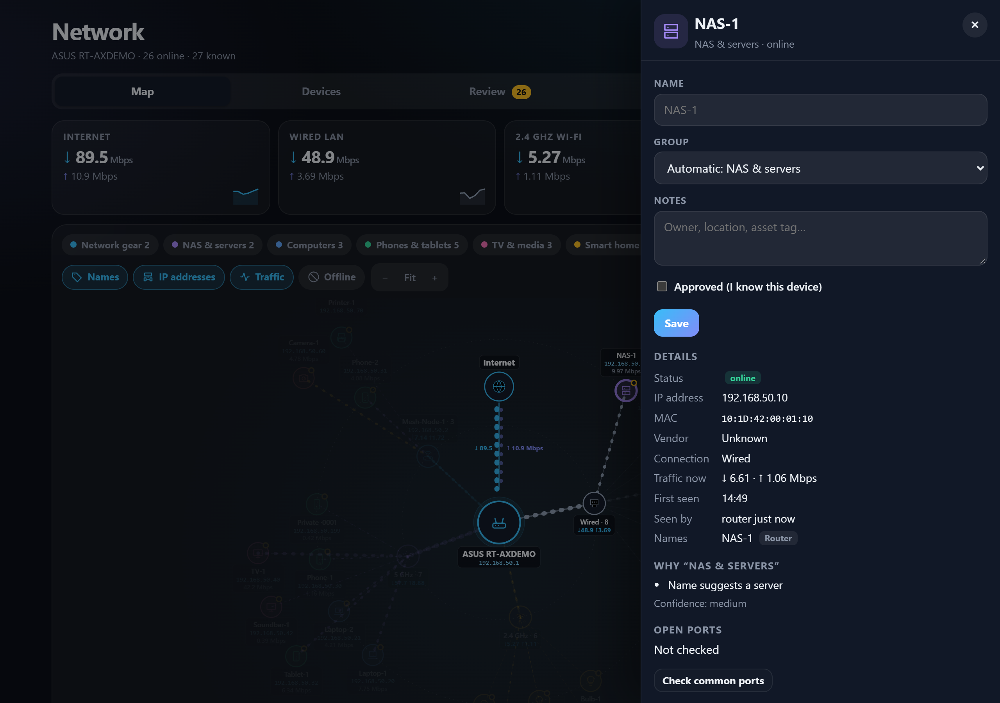
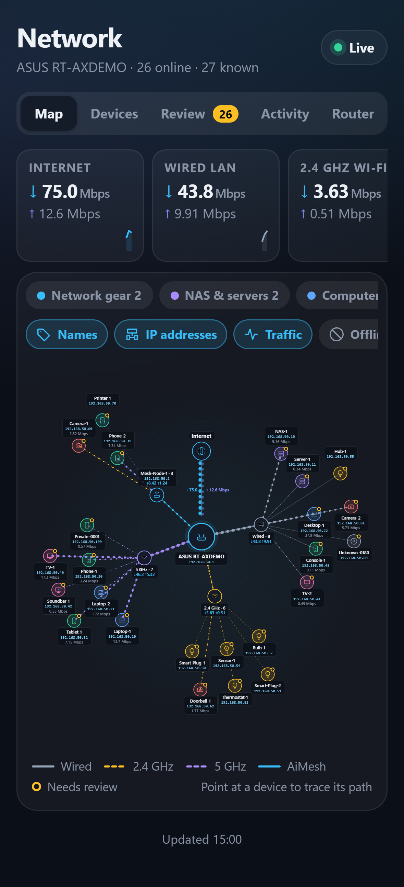

# Home Network Inventory

A small Docker app for the NAS that keeps an inventory of everything on the home network and draws a live map of it, with the ASUS router in the centre.

- **Finds devices on its own.** Anything that joins the network shows up within a couple of minutes, from two sources: the router's own client list and a scan from the NAS.
- **Sorts them into groups**: network gear, NAS & servers, computers, phones & tablets, TV & media, smart home & IoT, cameras, printers. Each device shows *why* it was put in its group, and any group you set by hand always wins.
- **Live network map.** The router is in the centre, the Internet, wired LAN, each Wi-Fi band and any AiMesh nodes branch off it, and every device hangs off the link it uses. Live throughput animates on the links, each kind of link (wired, 2.4, 5 and 6 GHz, AiMesh) has its own colour, and pointing at a device traces its path to the router. Toggles show or hide names, IP addresses, traffic and offline devices, and small graphs show the last two minutes of traffic.
- **Security features.** A review queue for devices you haven't approved, alerts for new devices, IP address history, a flag for private (random) MAC addresses, and a hint when a phone has probably come back with a new random MAC. The inventory exports to CSV and JSON.

| Map | Device details | iPhone |
| --- | --- | --- |
|  |  |  |

*(Screenshots use demo data from the fake router in `tests/`.)*

## How it works

```
                      ┌──────────── Docker on the NAS (host network) ────────────┐
ASUS router  ◀── read only ──  Router reader: client list (60 s), traffic (3 s, while the map is open)
192.168.50.1:8443             │                                                          │
                      │  Scanner: ARP sweep of 192.168.50.0/24 (2 min)                     │
devices on    ◀── lookups ──  Names & clues: reverse DNS, Bonjour/mDNS, UPnP/SSDP, NetBIOS   │
192.168.50.x          │  Classifier ──▶ SQLite inventory + activity log (./data volume)  │
                      └──────────────── web page http://<NAS-IP>:8089 ────────────────────┘
```

**The router** (stock ASUS firmware) is read through the same endpoints the ASUS Router phone app uses (`login.cgi`, `appGet.cgi`). The app gets:

- the client list (name, IP, MAC, wired or which Wi-Fi band, signal, link speed, AiMesh node)
- the interface byte counters (Internet, wired, each band), which give live throughput
- per-device traffic, if Traffic Analyzer is on (see below)

It **never** calls `apply.cgi`, so it cannot change a setting.

**The scan** sends one empty UDP packet to each address. That makes the NAS's kernel look the address up with ARP, and the app then reads the kernel's neighbour table. This finds devices that ignore ping and have firewalls, and it needs **no raw sockets or extra Linux capabilities**. Then, for new or unnamed devices only, it collects names and clues:

- the router's DNS (DHCP host names)
- Bonjour/mDNS (AirPlay, Chromecast, HomeKit, printers, model numbers)
- UPnP/SSDP (TVs, NAS, gateways)
- NetBIOS (Windows PCs)

**Classification** is a set of readable rules in [`app/classify.py`](app/classify.py). Each clue adds points to a group, and the most points wins. The rules that fired appear on the device as "Why *Computers*", with a high, medium or low confidence. Wrong guesses are fixed with one tap, and the fix is kept.

## Throughput on the map

| What | Where it comes from | Needs |
| --- | --- | --- |
| Internet ↓/↑ | Router's WAN byte counters | Nothing |
| Wired LAN, 2.4 GHz, 5 GHz (and 6 GHz) | Router's interface counters | Nothing |
| Each device | Router's `getTraffic.asp` | **Traffic Analyzer** on in the router (*Adaptive QoS → Traffic Analyzer → Statistic*, enable) |

Without Traffic Analyzer, the map shows the interface totals and each device's Wi-Fi link speed and signal. The page says when per-device traffic isn't available. Turning on Traffic Analyzer or Adaptive QoS switches off the router's hardware NAT acceleration. On a VDSL line that's fine; on a gigabit fibre line it can cap your speed.

Traffic is only read while someone has the map open (every 3 seconds). It stops a minute after the page closes, so the router isn't polled for nothing.

> **Check per-device directions on first run.** `getTraffic.asp` isn't documented by ASUS, and its format varies between firmware versions. The app assumes each row is `[mac, sent-to-device, received-from-device]`. If a device's ↓ and ↑ look swapped, or nothing shows, set `DEBUG_ENDPOINTS=1` and open `/api/debug/router?hook=/getTraffic.asp`. Send me the first few lines with the MACs blanked and I'll adjust the parser.

## Router login

Stock ASUS firmware allows **one admin web session at a time**. The app logs in once and reuses that session. It logs in again only when the router ends the session.

- If you log in to the router's web page, the app's session may be ended, or yours may be. Before you log in, tap **Router → Pause 15 min**. The app logs out and stays away for 15 minutes.
- A wrong password is tried once, then the app waits 30 minutes. That stops it tripping the router's login lockout or CAPTCHA.
- **Create a separate account if your model allows it** (*Administration → System*). Most stock firmware has only one admin account, so the app usually uses the main one. The password lives only in `.env` on the NAS.

**HTTPS certificate.** The router's certificate is self-signed. On the first connection the app records its SHA-256 fingerprint and refuses any other certificate from then on. A firmware update or reset can change the certificate legitimately. When that happens, the app stops, shows the new fingerprint, and offers **Trust new certificate** after you've checked it on the router. To pin the fingerprint from the start, set `ROUTER_CERT_SHA256`.

## Set up on the QNAP

You need Container Station.

1. **Connect:** `ssh <your-admin-user>@<NAS-IP>` (if a menu appears, press **Q**, then **Y**).
2. **Get the code** (paste one line at a time):
   ```sh
   cd /share/Container
   wget https://github.com/YabbaYabbaYabba/home-network-inventory/archive/refs/heads/main.tar.gz -O hni.tar.gz
   tar xzf hni.tar.gz && mv home-network-inventory-main home-network-inventory && cd home-network-inventory
   cp .env.example .env
   ```
3. **Add the router login.** `ROUTER_USER` must be the username you type on the router's login page. Newer ASUS firmware makes you choose one at setup, so it often isn't `admin`. Then add the password: `vi .env` → go to `ROUTER_PASSWORD=` → **Shift+A**, type it, **Esc**, `:wq`. Then:
   ```sh
   chmod 600 .env
   grep -c '^ROUTER_PASSWORD=.' .env     # prints 1 when it's set
   ```
4. **Check the NAS can reach the router:** `curl -skI https://192.168.50.1:8443/Main_Login.asp | head -1` should print an HTTP status line.
5. **Start it:**
   ```sh
   sudo docker compose up -d --build
   sudo docker compose logs --tail 30      # look for "Logged in to the router" and "Pinned the router's certificate"
   ```
   On older Container Station versions, use `docker-compose` instead.
6. Open **`http://<NAS-IP>:8089`**. On the iPhone, open it in Safari, then **Share → Add to Home Screen**.

**First run.** Everything found in the first pass lands in **Review**. Approve the devices you recognise, or tap **Approve all**, then look at what's left. From then on, every new device raises an alert.

To update later, download the archive into a new folder, copy `.env` across, and run `sudo docker compose up -d --build`. The inventory is kept in the `inventory-data` volume.

### Why `network_mode: host`

ARP, Bonjour and UPnP only work on the same network segment as the devices. In Docker's default bridge network, the container sits on a private 172.x network and can't see them. If host networking isn't allowed, the app still works from the router's client list alone, without the scan and the extra name/type clues, and the page says so.

Port 8089 is used directly on the NAS, so pick another with `PORT=` if 8089 is taken.

## Settings (`.env`)

| Setting | Default | Meaning |
| --- | --- | --- |
| `ROUTER_URL` | `https://192.168.50.1:8443` | Router address, as in your browser |
| `ROUTER_USER` / `ROUTER_PASSWORD` | `admin` / – | Router admin login |
| `ROUTER_CERT_SHA256` | – | Pin the router certificate (otherwise pinned on first use) |
| `APP_PASSWORD` | – | If set, the page asks for this password (HTTP basic auth, any username) |
| `ALERT_WEBHOOK_URL` | – | New-device alerts. Works with ntfy (`https://ntfy.sh/your-topic`), Slack, Discord and Home Assistant webhooks |
| `PORT` | `8089` | Web page port on the NAS |
| `TZ` | `UTC` | Time zone for times in the app, e.g. `Europe/London` |
| `SCAN` / `SCAN_SECONDS` | `1` / `120` | Network scan on/off and interval |
| `SCAN_SUBNET` | from the router | e.g. `192.168.50.0/24`; at most 1,024 addresses are scanned |
| `CLIENTS_SECONDS` | `60` | How often the router's client list is read |
| `LIVE_SECONDS` | `3` | Map refresh interval while it's open |
| `DEVICE_TRAFFIC` | `auto` | `auto` (use Traffic Analyzer if available), `on`, `off` |
| `MDNS` / `SSDP` / `NETBIOS` | `1` | Discovery methods for names and device types |
| `PORT_PROBE` | `0` | `1` = check 19 common TCP ports on each new device (helps classification; some IDS will notice). You can always check one device by hand from its page. |
| `OFFLINE_AFTER_SECONDS` | `600` | A device is offline after this long unseen |
| `KEEP_DAYS` | `365` | How long activity and IP history are kept |
| `DEBUG_ENDPOINTS` | `0` | `1` turns on `/api/debug/router?hook=get_clientlist()` (read-only hooks only) |

## Security notes

- **Read-only towards the router.** Only `login.cgi`, `appGet.cgi` (the firmware's "get" endpoint), `getTraffic.asp` and `Logout.asp` are used. Settings are changed through `apply.cgi`, which the app never calls, and the debug endpoint only passes `name(arg)`-style get hooks.
- **Least privilege container.** It runs as a non-root user (uid 10002) with `cap_drop: ALL`, `no-new-privileges`, a read-only root filesystem and a 256 MB memory cap. It needs no `NET_RAW` or `NET_ADMIN`, because the scan uses ordinary UDP sockets and the kernel's ARP table.
- **Gentle on the network.** The scan sends about 500 tiny UDP packets every 2 minutes, at most about 1,500 a second. Name lookups run only for new devices, plus one multicast round every 15 minutes. Port checks are off unless you turn them on.
- **Router credentials** live only in `.env` on the NAS (git-ignored, `chmod 600`). They never reach the browser.
- **Certificate pinning** for the router's HTTPS (see above).
- **Web page:** strict Content-Security-Policy (no third-party scripts, fonts or trackers), `no-store` on API calls, and anti-CSRF checks on every change (custom header plus Origin check). The CSV export escapes device-supplied names so they can't run as spreadsheet formulas. Data from devices (names, Bonjour/UPnP replies) is size-capped and treated as untrusted text everywhere. UPnP descriptions are only fetched from the device that announced them.
- The page is plain HTTP on the LAN. Don't port-forward it. Use a VPN to reach it from outside, and set `APP_PASSWORD` if other people use the Wi-Fi.

## Troubleshooting

| You see | Do this |
| --- | --- |
| "Wrong router username or password" | Check that `ROUTER_USER` is the name you log in to the router with (often not `admin`), then check the password. Check `.env`, then `sudo docker compose restart`. The app waits 30 min after a failure, or tap **Retry now**. |
| "Another admin is logged in" | Log out of the router's web page (or wait), then **Retry now** |
| "The router's HTTPS certificate has changed" | Compare the fingerprint with the router's, then **Trust new certificate** |
| "Scanning is off: this container isn't on the home network" | `network_mode: host` is missing or not allowed. Devices still come from the router. |
| A device is in the wrong group | Open it, choose the group, Save. If a rule is plainly wrong for a common device, tell me what it is and I'll fix the rule. |
| Phones keep appearing as new devices | iOS/Android private addresses. Per network they are normally stable. If "Rotate Wi-Fi address" is on, a new one appears now and then; the Review list points at the device it probably replaced. |

## Try it without the router

```sh
pip install -r requirements.txt pytest
python tests/fake_asus.py &                       # fake ASUS router on http://127.0.0.1:8443
ROUTER_URL=http://127.0.0.1:8443 ROUTER_PASSWORD=pw SCAN=0 python -m app.server   # http://127.0.0.1:8089
python -m pytest tests                            # parsing, classification, router session, cert pinning
```

`FAKE_TLS=1` runs the fake router over HTTPS with a throwaway certificate. `FAKE_TRAFFIC=0` behaves like a router with Traffic Analyzer off.
